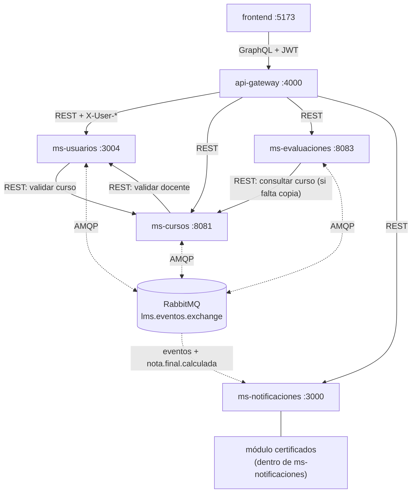
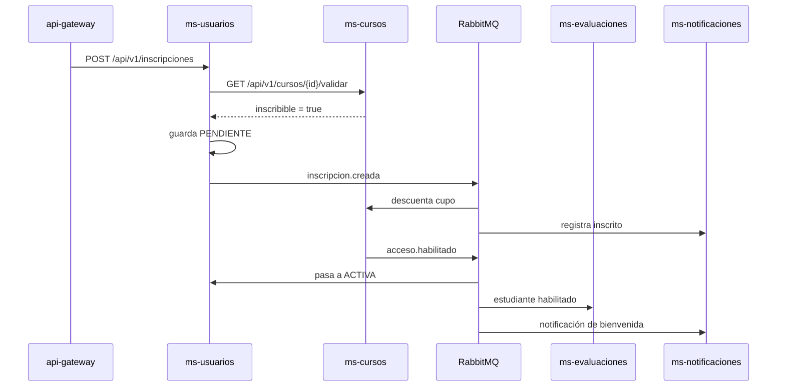
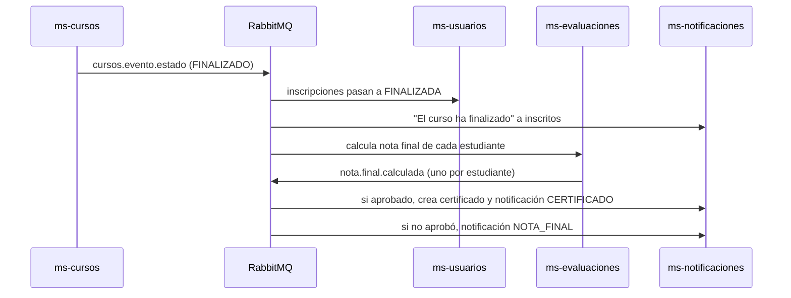

# Plan de integración: comunicación entre todos los microservicios

Responsable: todo el equipo. Este archivo manda sobre los demás: si un plan de servicio dice algo distinto, vale lo que está aquí.

Tiene dos partes. La primera (secciones 1 a 7) es el contrato que todos tienen que respetar: puertos, cabeceras, formato de errores, eventos y sus payloads. La segunda (secciones 8 a 11) es lo que hay que desarrollar y configurar para que todo funcione junto.

## 1. Cuestionario del equipo

Se responde en una reunión antes de que cualquiera empiece sus tareas. Si una respuesta queda vacía, ningún agente debe programar.

**I1. ¿Se aceptan los eventos nuevos `acceso.habilitado`, `inscripcion.rechazada`, `inscripcion.cancelada`, `evaluacion.publicada` y `nota.final.calculada`?**
Recomendada: sí. Sin `acceso.habilitado` la inscripción nunca se confirma y el flujo que pide el ABP (inscripción, evento, habilitación) no se puede mostrar. `nota.final.calculada` reemplaza a `certificado.emitido`, porque ahora los certificados los genera ms-notificaciones.
Respuesta:

**I2. Usuario y contraseña de RabbitMQ para todos.**
Recomendada: `lms` / `lms123`. `guest` no funciona entre contenedores.
Respuesta:

**I3. ¿Una sola versión de PostgreSQL?**
Recomendada: `postgres:16-alpine` para las cuatro bases. Hoy hay 15 y 16.
Respuesta:

**I4. ¿Los microservicios publican sus puertos en el host?**
Recomendada: en desarrollo sí (para Swagger y Postman), en el compose de entrega solo el gateway, el frontend y el panel de RabbitMQ. Se maneja con un `docker-compose.override.yml` que solo se usa en desarrollo.
Respuesta:

**I5. ¿Quién mantiene el `docker-compose.yml` raíz y la carpeta `contratos/`?**
Recomendada: una persona, que revisa todos los PR que toquen esos archivos.
Respuesta:

**I6. ¿Dónde corre RabbitMQ mientras cada uno desarrolla en su máquina?**
Recomendada: cada uno levanta su propio RabbitMQ con su `docker-compose.local.yml`, y se prueba la integración con el compose raíz en una sola máquina.
Respuesta:

**I7. Prefijo de los contenedores.**
Recomendada: `lms_` en lugar de `siged_`, que viene de otro proyecto.
Respuesta:

**I8. ¿Se usa el patrón Outbox para no perder eventos si RabbitMQ está caído?**
Recomendada: no por el alcance; se publica después de guardar y se registra el fallo. Se menciona en las recomendaciones del informe.
Respuesta:

## 2. Mapa de comunicación



Llamadas HTTP entre servicios (las únicas permitidas):

| Quién llama | A quién | Ruta | Para qué |
|---|---|---|---|
| ms-usuarios | ms-cursos | `GET /api/v1/cursos/{id}/validar` | Antes de inscribir |
| ms-cursos | ms-usuarios | `GET /api/v1/usuarios/docentes/{id}` | Al crear o editar un curso |
| ms-evaluaciones | ms-cursos | `GET /api/v1/cursos/{id}` | Solo si el curso no está en su copia local |
| api-gateway | todos | las de cada plan | Atender al frontend |

## 3. Puertos y nombres

| Servicio | Nombre en Docker | Puerto interno | Base de datos | Nombre de la BD |
|---|---|---|---|---|
| frontend | `frontend` | 5173 | | |
| api-gateway | `api-gateway` | 4000 | | |
| ms-usuarios | `ms-usuarios` | 3004 | `db_usuarios` | `usuarios_db` |
| ms-cursos | `ms-cursos` | 8081 | `db_cursos` | `cursos_db` |
| ms-evaluaciones | `ms-evaluaciones` | 8083 | `db_evaluaciones` | `evaluaciones_db` |
| ms-notificaciones (con certificados) | `ms-notificaciones` | 3000 | `db_notificaciones` | `notificaciones_db` |
| RabbitMQ | `rabbitmq` | 5672 (AMQP), 15672 (panel) | | |

Dentro de Docker los servicios se llaman por nombre (`http://ms-cursos:8081`), nunca por `localhost`.

## 4. Autenticación entre gateway y servicios

ms-usuarios crea el JWT; el gateway lo valida; los servicios confían en las cabeceras que pone el gateway.

Payload del JWT: `{ "id": "UUID", "email": "...", "rol": "ESTUDIANTE", "iat": ..., "exp": ... }`, con duración de 24 horas y firmado con `JWT_SECRET` (el mismo valor en ms-usuarios y en el gateway).

| Cabecera | Valor |
|---|---|
| `X-User-Id` | UUID del usuario |
| `X-User-Rol` | `ADMINISTRADOR`, `DOCENTE` o `ESTUDIANTE` |

En las llamadas entre servicios (tabla de la sección 2) no se mandan estas cabeceras; esas rutas son internas.

## 5. Formato común de datos y errores

| Elemento | Regla | Ejemplo |
|---|---|---|
| IDs | UUID v4 | `"3f2b9c1e-8a4d-4f1e-9b2a-7c6d5e4f3a21"` |
| Campos JSON | camelCase | `cursoId` |
| Columnas | snake_case | `curso_id` |
| Fechas | ISO 8601 sin zona, hora de Ecuador | `"2026-11-10T10:00:00"` |
| Enumeraciones | MAYÚSCULAS | `EN_CURSO` |
| Notas | 0 a 10, un decimal | `8.5` |
| Rutas | `/api/v1/<recurso-en-plural>` | `/api/v1/inscripciones` |

Error común (todos los servicios):

```json
{ "timestamp": "2026-11-10T10:15:30", "status": 409, "error": "CUPO_AGOTADO",
  "mensaje": "El curso SD-2026-01 no tiene cupos disponibles", "ruta": "/api/v1/inscripciones" }
```

Valores de `error` acordados: `DATOS_INVALIDOS` (400), `NO_AUTENTICADO` (401), `PROHIBIDO` (403), `NO_ENCONTRADO` (404), `YA_INSCRITO`, `CUPO_AGOTADO`, `CURSO_NO_DISPONIBLE`, `TRANSICION_INVALIDA`, `CODIGO_DUPLICADO`, `PESO_EXCEDIDO`, `ESTUDIANTE_NO_HABILITADO`, `EVALUACION_CERRADA` (409), `SERVICIO_NO_DISPONIBLE` (503). Si un servicio necesita uno nuevo, lo agrega aquí en el mismo PR.

## 6. Contrato de eventos

### 6.1 Exchange y colas

| Elemento | Valor |
|---|---|
| Exchange | `lms.eventos.exchange`, topic, durable |
| Formato | JSON, `content_type: application/json`, mensajes persistentes |
| Usuario | el de I2 |

| Servicio | Cola | Routing keys enlazadas | Cola de errores |
|---|---|---|---|
| ms-usuarios | `lms.usuarios.inscripciones.queue` | `acceso.habilitado`, `inscripcion.rechazada`, `cursos.evento.estado` | `lms.usuarios.dlq` |
| ms-cursos | `lms.cursos.inscripciones.queue` | `inscripcion.creada`, `inscripcion.cancelada` | `lms.cursos.dlq` |
| ms-evaluaciones | `lms.evaluaciones.queue` | `acceso.habilitado`, `inscripcion.cancelada`, `cursos.evento.#` | `lms.evaluaciones.dlq` |
| ms-notificaciones | `lms.notificaciones.queue` | `inscripcion.#`, `acceso.habilitado`, `cursos.evento.#`, `evaluacion.#`, `nota.final.calculada` | `lms.notificaciones.dlq` |

Cada consumidor crea su propia cola al arrancar. Nadie crea colas para otro servicio.

### 6.2 Reglas para todos los consumidores

- Revisar el `eventoId` antes de procesar; si ya se procesó, confirmar el mensaje (ack) sin hacer nada.
- Mensaje mal formado (JSON roto, UUID inválido, falta un campo obligatorio): rechazar sin reintentar, va a la cola de errores.
- Error temporal (BD caída): devolver a la cola para reintentar.
- Reconectar a RabbitMQ si se cae la conexión.

### 6.3 Campos comunes

Todo evento lleva `eventoId` (UUID), `tipoEvento` (texto) y `fechaEvento` (fecha). Los demás campos dependen del evento.

### 6.4 Catálogo de eventos

| Routing key | tipoEvento | Publica | Consumen |
|---|---|---|---|
| `inscripcion.creada` | `InscripcionCreada` | ms-usuarios | ms-cursos, ms-notificaciones |
| `inscripcion.cancelada` | `InscripcionCancelada` | ms-usuarios | ms-cursos, ms-evaluaciones, ms-notificaciones |
| `acceso.habilitado` | `AccesoHabilitado` | ms-cursos | ms-usuarios, ms-evaluaciones, ms-notificaciones |
| `inscripcion.rechazada` | `InscripcionRechazada` | ms-cursos | ms-usuarios, ms-notificaciones |
| `cursos.evento.creado` | `CursoCreado` | ms-cursos | ms-evaluaciones, ms-notificaciones |
| `cursos.evento.actualizado` | `CursoActualizado` | ms-cursos | ms-evaluaciones, ms-notificaciones |
| `cursos.evento.estado` | `CursoPublicado` o `EstadoCursoCambiado` | ms-cursos | ms-usuarios, ms-evaluaciones, ms-notificaciones |
| `cursos.evento.cupo` | `CupoCursoActualizado` | ms-cursos | ms-evaluaciones, ms-notificaciones |
| `cursos.evento.eliminado` | `CursoEliminado` | ms-cursos | ms-evaluaciones, ms-notificaciones |
| `evaluacion.publicada` | `EvaluacionPublicada` | ms-evaluaciones | ms-notificaciones |
| `evaluacion.calificada` | `EvaluacionCalificada` | ms-evaluaciones | ms-notificaciones |
| `nota.final.calculada` | `NotaFinalCalculada` | ms-evaluaciones | ms-notificaciones (emite el certificado si `aprobado` es true) |

`certificado.emitido` ya no se usa: el certificado se crea dentro de ms-notificaciones y no hace falta avisar a otro servicio.

### 6.5 Payloads

`inscripcion.creada` (el formato que ya esperan ms-cursos y ms-notificaciones, más los campos comunes):

```json
{ "eventoId": "UUID", "tipoEvento": "InscripcionCreada", "inscripcionId": "UUID", "cursoId": "UUID",
  "estudianteId": "UUID", "estadoInscripcion": "PENDIENTE", "fechaInscripcion": "2026-11-10T10:00:00",
  "fechaEvento": "2026-11-10T10:00:00" }
```

`inscripcion.cancelada`: mismo formato con `"tipoEvento": "InscripcionCancelada"` y `"estadoInscripcion": "CANCELADA"`.

`acceso.habilitado`:

```json
{ "eventoId": "UUID", "tipoEvento": "AccesoHabilitado", "inscripcionId": "UUID", "cursoId": "UUID",
  "estudianteId": "UUID", "codigoCurso": "SD-2026-01", "tituloCurso": "Sistemas Distribuidos",
  "fechaEvento": "2026-11-10T10:00:01" }
```

`inscripcion.rechazada` (`motivo`: `CUPO_AGOTADO`, `CURSO_NO_DISPONIBLE` o `CURSO_NO_EXISTE`):

```json
{ "eventoId": "UUID", "tipoEvento": "InscripcionRechazada", "inscripcionId": "UUID", "cursoId": "UUID",
  "estudianteId": "UUID", "motivo": "CUPO_AGOTADO", "fechaEvento": "2026-11-10T10:00:01" }
```

`cursos.evento.*` (ya implementado en `CursoEventoPayload`, no se cambia):

```json
{ "eventoId": "UUID", "tipoEvento": "EstadoCursoCambiado", "cursoId": "UUID", "codigoCurso": "SD-2026-01",
  "titulo": "Sistemas Distribuidos", "docenteId": "UUID", "estado": "EN_CURSO", "cuposDisponibles": 38,
  "precio": 0.00, "fechaEvento": "2026-11-15T08:00:00" }
```

`evaluacion.publicada`:

```json
{ "eventoId": "UUID", "tipoEvento": "EvaluacionPublicada", "evaluacionId": "UUID", "cursoId": "UUID",
  "tituloEvaluacion": "Examen parcial", "fechaCierre": "2026-11-25T23:59:00", "fechaEvento": "2026-11-18T08:00:00" }
```

`evaluacion.calificada` (obligatorios para ms-notificaciones: `estudianteId` y `nota`):

```json
{ "eventoId": "UUID", "tipoEvento": "EvaluacionCalificada", "evaluacionId": "UUID", "estudianteId": "UUID",
  "cursoId": "UUID", "tituloEvaluacion": "Examen parcial", "tituloCurso": "Sistemas Distribuidos",
  "nota": 8.5, "fechaEvento": "2026-11-20T15:00:00" }
```

`nota.final.calculada` (uno por cada estudiante habilitado cuando el curso finaliza; obligatorios: `cursoId`, `estudianteId`, `notaFinal`, `aprobado`):

```json
{ "eventoId": "UUID", "tipoEvento": "NotaFinalCalculada", "cursoId": "UUID", "codigoCurso": "SD-2026-01",
  "tituloCurso": "Sistemas Distribuidos", "estudianteId": "UUID", "notaFinal": 8.7, "aprobado": true,
  "notaMinima": 7.0, "fechaEvento": "2026-12-20T10:00:00" }
```

## 7. Flujo principal que tiene que funcionar



Si no hay cupo, ms-cursos publica `inscripcion.rechazada`: ms-usuarios marca RECHAZADA y ms-notificaciones avisa al estudiante.

Al finalizar el curso:



## 8. Lo que hay que desarrollar y configurar para la integración

Esta es la lista que no pertenece a un solo servicio. La hace el responsable de I5, salvo donde dice otra cosa.

- [ ] **C1. Carpeta `contratos/`** en la raíz:
  ```
  contratos/
  ├── eventos/        # un .json de ejemplo por cada routing key de la sección 6.4
  ├── rest/           # OpenAPI de cada servicio (los Java lo exportan desde /api-docs)
  └── graphql/
      └── schema.graphql
  ```
  El `schema.graphql` inicial se arma con los tipos y operaciones que listan `api-gateway.md` (T5 a T8) y `frontend.md`, y lo aprueba todo el equipo.

- [ ] **C2. `.env.example` en la raíz** con todas las credenciales que usa el compose: usuario y clave de cada base, usuario de RabbitMQ, `JWT_SECRET`. El `.env` real no se sube.

- [ ] **C3. `docker-compose.yml` raíz completo.** Hoy tiene RabbitMQ, las cuatro bases, ms-cursos, ms-usuarios y el gateway. Hay que:
  1. Agregar ms-evaluaciones, ms-notificaciones y el frontend.
  2. Poner las variables de entorno de cada servicio tal como están en su plan, leyendo del `.env`.
  3. RabbitMQ con `RABBITMQ_DEFAULT_USER` y `RABBITMQ_DEFAULT_PASS` de I2.
  4. Bases con la imagen de I3 y un volumen con nombre cada una.
  5. Healthchecks: `pg_isready` en las bases, `rabbitmq-diagnostics -q ping` en RabbitMQ, y la ruta de health en cada servicio.
  6. `depends_on` con `condition: service_healthy` (cada servicio espera a su base y a RabbitMQ; el gateway espera a los cuatro servicios).
  7. Dos redes: `lms-front` (frontend, gateway) y `lms-back` (gateway, servicios, bases, RabbitMQ).
  8. `restart: unless-stopped` en los servicios.
  9. Nombres de contenedor con el prefijo de I7.
  10. Puertos según I4.

- [ ] **C4. `docker-compose.override.yml`** solo para desarrollo, que publica los puertos de los servicios (3004, 8081, 8083, 8004) y activa el perfil `dev` de ms-cursos para el simulador.

- [ ] **C5. Desactivar simulaciones.** En el compose raíz: `USUARIOS_SERVICE_MOCK=false` en ms-cursos y sin perfil `dev`. Se hace cuando ms-usuarios tenga su T6.

- [ ] **C6. Datos iniciales.** Un administrador (T9 de ms-usuarios), un docente y un estudiante de prueba, y el curso SD-2026-01 que ya crea `DataInitializer`, con `docenteId` igual al UUID del docente de prueba. Acordar ese UUID y anotarlo aquí: `__________`.

- [ ] **C7. README raíz** con cómo levantar todo, las URLs (frontend, Apollo Sandbox, panel de RabbitMQ, Swagger de los servicios Java) y los usuarios de prueba.

## 9. Orden de integración

Cada paso empieza cuando el anterior está probado.

| Paso | Qué se integra | Requisito | Cómo se prueba |
|---|---|---|---|
| 1 | Todos en el mismo exchange | ms-evaluaciones T1, credenciales de I2 | En el panel de RabbitMQ aparecen las cuatro colas de la sección 6.1 |
| 2 | ms-usuarios ↔ ms-cursos por HTTP | ms-usuarios T6 y T7, ms-cursos T9 | Crear un curso con un docente real; inscribir validando el curso |
| 3 | Saga de inscripción | ms-usuarios T8 y T9, ms-cursos T2 | Inscripción llega a ACTIVA y el cupo baja |
| 4 | Evaluaciones y notificaciones | ms-evaluaciones T5, ms-notificaciones T2 | Después de inscribir, el estudiante está habilitado en evaluaciones y tiene la bienvenida |
| 5 | Notas y certificados | ms-evaluaciones T7 y T9, ms-notificaciones T4 a T7 | Calificar y finalizar el curso genera NOTA, el certificado del aprobado y su notificación CERTIFICADO |
| 6 | Gateway | api-gateway T1 a T8 | Todas las operaciones en Apollo Sandbox |
| 7 | Frontend | frontend T1 a T7 | Recorrido T8 del frontend |
| 8 | Todo con un solo comando | C3 a C7 | `docker compose up -d --build` desde cero y recorrido completo |

## 10. Pruebas de integración

Se guardan con captura y tiempo para la sección de resultados del informe.

| Prueba | Pasos | Resultado esperado |
|---|---|---|
| Inscripción confirmada | Inscribir a un estudiante en un curso con cupo | ACTIVA, cupo −1, notificación INSCRIPCION |
| Inscripción rechazada | Curso con 1 cupo, dos inscripciones seguidas | Una ACTIVA y una RECHAZADA con su notificación |
| Evento duplicado | Publicar el mismo `inscripcion.creada` dos veces desde el panel | El cupo baja una sola vez |
| Mensaje inválido | Publicar JSON roto en cada routing key | Queda en la cola de errores del consumidor y el servicio sigue funcionando |
| Ciclo completo | Inscribir, iniciar curso, publicar y calificar evaluación, finalizar | El estudiante recibe las seis notificaciones en orden y su certificado |
| Certificado duplicado | Publicar dos veces el mismo `nota.final.calculada` con `aprobado: true` | Un solo certificado y una sola notificación CERTIFICADO |
| Verificación pública | Consultar `verificarCertificado` sin token con un código real y uno falso | El real devuelve los datos; el falso, `NO_ENCONTRADO` |
| Caída de ms-notificaciones | `docker stop` del servicio, inscribir, volver a levantar | La inscripción funciona; al volver, la notificación aparece |
| Caída de ms-evaluaciones | Detener el servicio y consultar un curso por GraphQL | El curso se muestra y `evaluaciones` viene en `null` con error |
| Caída de RabbitMQ | Detener RabbitMQ e inscribir | La inscripción queda PENDIENTE y el error queda en el log |

## 11. Ramas y PR de integración

- Cada servicio trabaja en `feature/<servicio>-<tema>` y abre PR a `develop`.
- Los cambios de `contratos/`, `integracion.md` y el compose raíz van en PR propios, revisados por el responsable de I5 y por los servicios afectados.
- Un cambio de contrato se mezcla antes que el código que lo usa.
- `develop` pasa a `main` al terminar los pasos 5 y 8 de la sección 9.
